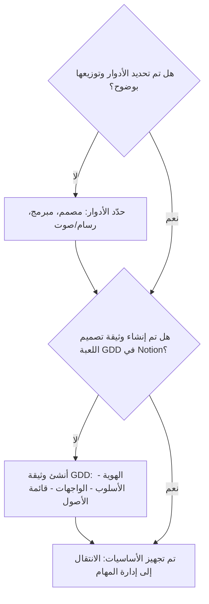
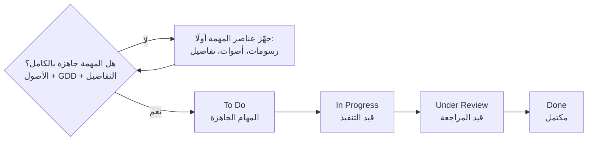
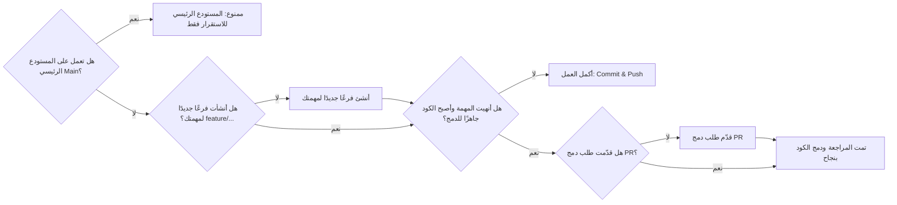
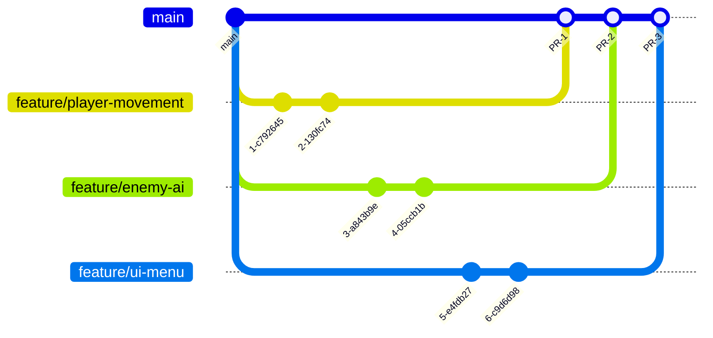

<div dir="rtl">

<div align="center">

# العبّارة: آخر الخريف

**The Ferry: Last Autumn**

لعبة رعب نفسي وغموض ومحاكاة

**المحرك:** GDevelop  |  **الحالة:** قيد التطوير

</div>

---

## فهرس المحتويات

**الجزء الأول: اللعبة**
1. [نبذة عن اللعبة](#1-نبذة-عن-اللعبة)
2. [أسلوب اللعب](#2-أسلوب-اللعب)
3. [مصدر الرعب](#3-مصدر-الرعب)
4. [تطور الأحداث](#4-تطور-الأحداث)
5. [النهاية](#5-النهاية)

**الجزء الثاني: دليل العمل (Carrot Workflow)**
6. [الهيكلة والأدوات](#6-الهيكلة-والأدوات-الأساسيات)
7. [إدارة المهام (Kanban)](#7-إدارة-المهام-kanban)
8. [إدارة الكود: العمل المتزامن دون تضارب](#8-إدارة-الكود-العمل-المتزامن-دون-تضارب)
9. [التواصل والمراسلات (Discord)](#9-التواصل-والمراسلات-discord)
10. [الدورة الأسبوعية للمطوّر](#10-الدورة-الأسبوعية-للمطوّر-the-weekly-loop)

**الجزء الثالث: إدارة الكود والتخزين (Git, GitHub & Google Drive)**
11. [هيكلة المشروع](#11-هيكلة-المشروع-repository)
12. [سير العمل باستخدام Feature Branching](#12-سير-العمل-باستخدام-feature-branching)
13. [دورة العمل للمطوّر (Git Workflow)](#13-دورة-العمل-للمطوّر-git-workflow)
14. [أفضل ممارسات الـ Commits](#14-أفضل-ممارسات-الـ-commits)
15. [قواعد استخدام الفروع](#15-قواعد-استخدام-الفروع-branches)
16. [رفع الأصول على Google Drive](#16-رفع-الأصول-على-google-drive)
17. [أوامر Git الأساسية](#17-أوامر-git-الأساسية)
18. [المبادئ العامة للفريق](#18-المبادئ-العامة-للفريق)

**الجزء الرابع: المساهمة**
19. [طريقة المساهمة](#19-طريقة-المساهمة)
20. [فريق العمل](#20-فريق-العمل)

---

# الجزء الأول: اللعبة

## 1. نبذة عن اللعبة

**النوع:** رعب نفسي، غموض، ومحاكاة.

**المحرك:** [GDevelop](https://gdevelop.io)

يتولّى اللاعب مسؤولية عبّارة تنقل الركاب بين الجزر. وفي كل رحلة، عليه أن يسجّل أسماء الركاب في دفتر الرحلة، ويتعرّف على حكاياتهم، ويراقب عددهم عند الوصول.

غير أن في الأمر مشكلة: فأحيانًا يكون على متن العبّارة راكب زائد، هو نسخة مزيّفة من أحد الركاب الحقيقيين.

## 2. أسلوب اللعب

تنقسم كل رحلة إلى ثلاث مراحل متتابعة:

| المرحلة | المهام |
|:---|:---|
| **الصعود** | تسجيل أسماء الركاب، وملاحظة أشكالهم وصناديقهم، وتحديد أماكنهم على متن القارب. |
| **الإبحار** | قيادة العبّارة وسط البحر، والتحدث مع الركاب لاكتشاف قصصهم والبحث عن أي تناقضات. |
| **النزول** | إعادة عدّ الركاب ومقارنة العدد بما هو مدوّن في الدفتر، ثم تحديد ما إذا كان بينهم شخص مزيّف. |

## 3. مصدر الرعب

يتحرك الراكب المزيّف كلما صرفتَ نظرك عنه، ويحاول تقليد شخص حقيقي بكل تفاصيله تقريبًا.

وللكشف عنه، على اللاعب استخدام أدوات مثل **المرآة** و**الفانوس** و**الحبل**، وملاحظة الفروق الدقيقة في شكله وتصرفاته. والأخطر من ذلك أنه قد يروي قصة راكب آخر كما لو كانت قصته هو.

## 4. تطور الأحداث

مع كل يوم ورحلة جديدة، يتغيّر الجو العام وتنكشف أسرار الجزر تدريجيًا.

| القرار | العاقبة المحتملة |
|:---|:---|
| إنزال الراكب المزيّف على جزيرة | قد يبدأ سكان الجزيرة بالاختفاء. |
| الاحتفاظ به على متن العبّارة | قد يظهر راكب مزيّف آخر في الرحلات التالية. |

لكل قرار عواقبه، وليس من الواضح دائمًا من هو الحقيقي ومن هو المزيّف.

## 5. النهاية

في الرحلة الأخيرة، يكتشف اللاعب أن **اسمه مكتوب مرتين** في دفتر الرحلة.

> هل كان هو الراكب المزيّف منذ البداية؟ أم أن نسخة منه كانت على متن العبّارة طوال الوقت؟

«العبّارة» لعبة عن العدّ والملاحظة والشك، حيث يمكن لخطأ واحد أن يغيّر مصير جزيرة كاملة، وقد تكون الثقة في الشخص الخطأ أخطر قرار في الرحلة.

---

# الجزء الثاني: دليل العمل (Carrot Workflow)

يمثّل هذا الجزء المنهجية المعتمدة لدى الفريق في تنظيم العمل، من تحديد الأدوار حتى تسليم النسخة التجريبية الأسبوعية.

**دليل الألوان المستخدم في المخطط الأصلي:**

| اللون | الدلالة |
|:---|:---|
| أبيض بحدود زرقاء | سؤال أو قرار |
| برتقالي | إجراء مطلوب |
| أخضر | تمّ الإنجاز / الانتقال إلى الخطوة التالية |

## 6. الهيكلة والأدوات (الأساسيات)



## 7. إدارة المهام (Kanban)



| العمود | المعنى |
|:---|:---|
| **To Do** | المهام الجاهزة |
| **In Progress** | قيد التنفيذ |
| **Under Review** | قيد المراجعة |
| **Done** | مكتمل |

**هل تعمل على أكثر من مهمة في الوقت نفسه؟**
- **نعم:** استمر في العمل وفق تدفّق اللوحة.
- **لا:** انتقل إلى مرحلة إدارة الكود.

## 8. إدارة الكود: العمل المتزامن دون تضارب



## 9. التواصل والمراسلات (Discord)

### الاجتماع الأسبوعي الصارم
يُعقد مرة واحدة أسبوعيًا، ويشمل:
- مدته 30 دقيقة في بداية الأسبوع.
- مراجعة المهام المستجدة.
- استعراض الإنجازات وتوزيع المهام.
- الالتزام بالإيجاز وتجنّب الإطالة.

### المكتب الافتراضي (The Lab)
- غرفة صوتية خاصة للعمل المشترك.
- مساحة للعمل بصحبة الزملاء، مع الموسيقى والدردشة.
- مخصّصة لحل المشكلات البرمجية الفورية.

### التحديث اليومي غير المتزامن (Async Daily)
يتم حصرًا في قناة `#daily-updates`، ويجيب كل عضو عن ثلاثة أسئلة:
1. ماذا أنجزت اليوم؟
2. ماذا ستعمل عليه؟
3. هل تواجهك مشكلة أو عائق؟

### الرقابة بالنتائج
- لا تُراقَب ساعات العمل.
- المعيار الوحيد للتقييم هو حركة المهام، وظهور الإنجازات في النسخة التجريبية.

## 10. الدورة الأسبوعية للمطوّر (The Weekly Loop)

| المرحلة | التوقيت | الإجراءات |
|:---|:---|:---|
| **1. التخطيط** | بداية الأسبوع | عقد الاجتماع العام لتوزيع المهام الواضحة والجاهزة. |
| **2. التنفيذ** | طوال الأسبوع | - تحديث حالة مهمتك باستمرار.<br/>- اقتراح الحلول ودراستها لمهمتك.<br/>- إجراء المراجعات داخل The Lab.<br/>- اختبار تحديثاتك أولًا، ثم Commit & Push. |
| **3. المراجعة** | قبل نهاية الأسبوع | - إنشاء طلب الدمج (PR) لمهمتك.<br/>- مراجعة كود الزملاء. |
| **4. التحضير الأسبوعي** | يوم الخميس | - استخراج نسخة تجريبية قابلة للعب.<br/>- أن تحتوي على كل إنجازات الأسبوع.<br/>- الاجتماع لمراجعتها ومناقشتها، وقياس الأداء وكشف الأخطاء. |

---

# الجزء الثالث: إدارة الكود والتخزين (Git, GitHub & Google Drive)

## 11. هيكلة المشروع (Repository)

تعتمد اللعبة على محرك **GDevelop**، ويأخذ المستودع الهيكلة التالية:

```text
Live stream first person horror game 2/      (جذر المستودع)
├── layouts/                                 (المشاهد - Scenes)
├── externalEvents/                          (الأحداث الخارجية)
├── eventsFunctionsExtensions/               (الدوال والإضافات المخصصة)
├── assets/                                  (الأصول: صور، صوتيات، وغيرها)
├── Hands.png                                (صورة اليدين)
├── Live stream first person horror game 2.json            (ملف المشروع الرئيسي)
├── Live stream first person horror game 2.json.autosave   (نسخة الحفظ التلقائي - لا تُرفع)
└── README.md
```

**وصف المحتويات:**

| العنصر | الوصف |
|:---|:---|
| `Live stream first person horror game 2.json` | ملف المشروع الرئيسي الذي يُفتح من GDevelop، ويحتوي على الإعدادات العامة وقائمة المشاهد. |
| `Live stream first person horror game 2.json.autosave` | نسخة الحفظ التلقائي التي ينشئها المحرك، وهي مؤقتة ولا تُرفع إلى المستودع. |
| `layouts/` | ملف مستقل لكل مشهد (Scene) من مشاهد اللعبة. |
| `externalEvents/` | الأحداث الخارجية القابلة لإعادة الاستخدام بين المشاهد. |
| `eventsFunctionsExtensions/` | الدوال والسلوكيات والإضافات المخصصة للمشروع. |
| `assets/` | جميع الأصول المستخدمة داخل اللعبة (رسومات، صوتيات، وغيرها). |
| `Hands.png` | صورة اليدين المستخدمة في منظور اللاعب. |
| `README.md` | ملف التعريف بالمشروع وبدليل العمل. |

**ملاحظات:**
- يُحفظ المشروع في GDevelop بصيغة **الملفات المتعددة**، فيكون لكل مشهد ودالة ملف مستقل. وهذا يقلّل تعارضات الدمج (Merge Conflicts) عندما يعمل أكثر من عضو على مشاهد مختلفة.
- يُنصح بألا يعمل عضوان على المشهد نفسه (Layout) في الوقت ذاته، لأن دمج ملفات GDevelop يدويًا صعب.
- تُحفظ النسخ الأصلية عالية الجودة من الأصول على Google Drive، ويحتوي مجلد `assets/` على النسخ المستخدمة داخل اللعبة فقط.

**مثال على ملف `.gitignore`:**

```gitignore
# نسخ الحفظ التلقائي الخاصة بـ GDevelop
*.autosave

# ملفات النظام
.DS_Store
Thumbs.db

# ملفات مؤقتة
Temp/
*.log

# نسخ البناء (Builds)
Builds/
```

## 12. سير العمل باستخدام Feature Branching

- تُدمج التحديثات في المستودع الرئيسي (`main`)، **ولا يُعدَّل عليه مباشرة**.
- كل ميزة جديدة تتطلب مراجعة عبر **Pull Request**.



## 13. دورة العمل للمطوّر (Git Workflow)

| # | الخطوة | الوصف | الأمر |
|:-:|:---|:---|:---|
| 1 | **تحديث المستودع** (Pull) | اجلب أحدث كود من الفرع الرئيسي إلى جهازك المحلي. | `git pull origin main` |
| 2 | **إنشاء فرع جديد** (Branch) | أنشئ فرعًا جديدًا لمهمتك أو ميزتك. | `git checkout -b feature/your-task` |
| 3 | **العمل على المهمة** | اعمل على الكود، وأضف التعديلات، واختبر محليًا عند الحاجة. | — |
| 4 | **حفظ التغييرات** (Commit) | احفظ التغييرات برسالة واضحة. | `git add .`<br/>`git commit -m "رسالة التوضيح"` |
| 5 | **دفع التغييرات** (Push) | ادفع الفرع إلى المستودع البعيد. | `git push origin feature/your-task` |
| 6 | **طلب الدمج** (Pull Request) | افتح طلب دمج لمراجعة الكود. | — |
| 7 | **المراجعة والدمج** (Merge) | راجع الطلب وأجرِ التعديلات، ثم ادمج في الفرع `main`. | — |

## 14. أفضل ممارسات الـ Commits

### هيكل الرسالة المثالية

```text
<type>: <short description>

(optional body)

(optional footer)
```

### أنواع الـ Commit الشائعة

| النوع | المعنى |
|:---|:---|
| `feat` | ميزة جديدة |
| `fix` | إصلاح خطأ |
| `docs` | تحديث المستندات والتوثيق |
| `style` | تنسيق الكود |
| `refactor` | إعادة هيكلة الكود |
| `test` | إضافة اختبارات |

### أمثلة

| أمثلة جيدة | أمثلة سيئة |
|:---|:---|
| `feat: add player jump mechanic` | `update` |
| `fix: enemy animation not playing` | `fix bug` |
| `docs: update GDD - combat section` | `new` |
| `refactor: improve AI system` | `test123` |

## 15. قواعد استخدام الفروع (Branches)

| القاعدة | التفصيل |
|:---|:---|
| **كل عمل في فرع واحد** | لا تعمل على أكثر من مهمة في الوقت نفسه. |
| **اسم الفرع واضح وموحّد** | استخدم صيغة مثل `feature/jump`. |
| **اسحب قبل الدمج دائمًا** | اسحب التغييرات من المستودع البعيد قبل دمج فرعك. |
| **احذف الفروع بعد الدمج** | احذف الفروع التي لم تعد بحاجة إليها بعد دمجها في `main`. |

## 16. رفع الأصول على Google Drive

**الخطوات:**
1. **إنشاء مجلدات:** Characters، Environment، UI، Audio، VFX.
2. **رفع الملفات:** ارفع الأصول على Google Drive ونظّمها.
3. **مشاركة الرابط:** شارك الرابط مع أعضاء الفريق للمشاهدة والمساهمة في التعديل.
4. **تحديث مستمر:** زامن التحديثات مع الفريق بانتظام (مثل: GDD).

**تنسيقات الملفات المدعومة** (الصور، النماذج، الصوتيات، وغيرها):

`.jpg` `.png` `.mp3` `.wav` `.fbx` `.glb` `.obj` `.txt` `.json` `.mp4` `.m4a` `.ogg`

> تأكد من تنظيم الملفات داخل المجلدات المناسبة.

## 17. أوامر Git الأساسية

| الأمر | الوصف |
|:---|:---|
| `git pull origin main` | جلب آخر التحديثات من الفرع الرئيسي |
| `git checkout -b feature/xxx` | إنشاء فرع جديد باسم feature/xxx |
| `git status` | عرض حالة الملفات |
| `git add .` | إضافة الملفات المتغيّرة إلى التعديل |
| `git commit -m "msg"` | حفظ التغييرات برسالة توضيحية |
| `git push origin feature/xxx` | دفع الفرع إلى المستودع البعيد |
| `git checkout main` | الرجوع إلى الفرع الرئيسي |
| `git branch -d feature/xxx` | حذف فرع مكتمل |
| `git push origin --delete feature/xxx` | حذف فرع بعيد |

## 18. المبادئ العامة للفريق

1. **لا تغيّر في `main` مباشرة.** المستودع الرئيسي مخصّص للاستقرار فقط.
2. **مراجعات الكود دائمة (Code Review).** لا يُدمج شيء دون مراجعة.
3. **النتائج (Builds) هي المعيار.** العبرة بما يُنجَز لا بساعات العمل.
4. **التواصل المستمر** بين المطوّرين عبر أي منصة متوفرة.
5. **الارتقاء بمستوى الفريق**، هواةً ومحترفين، من خلال العمل على محرك GDevelop.

---

# الجزء الرابع: المساهمة

## 19. طريقة المساهمة

1. اطّلع على دليل **Carrot Workflow** بالكامل قبل البدء.
2. حدّث فرعك المحلي من `main`، ثم أنشئ فرعًا جديدًا باسم `feature/your-task`.
3. نفّذ مهمتك، واحفظ تغييراتك برسائل Commit واضحة وفق الصيغة المعتمدة، ثم ادفعها.
4. افتح **Pull Request** وانتظر المراجعة.
5. بعد الدمج، احذف الفرع.

## 20. فريق العمل

| الدور | الاسم |
|:---|:---|
| المصمم | — |
| المبرمج | — |
| الرسام / مهندس الصوت | — |

---

<div align="center">

**مبنية بمحرك GDevelop**

</div>

</div>